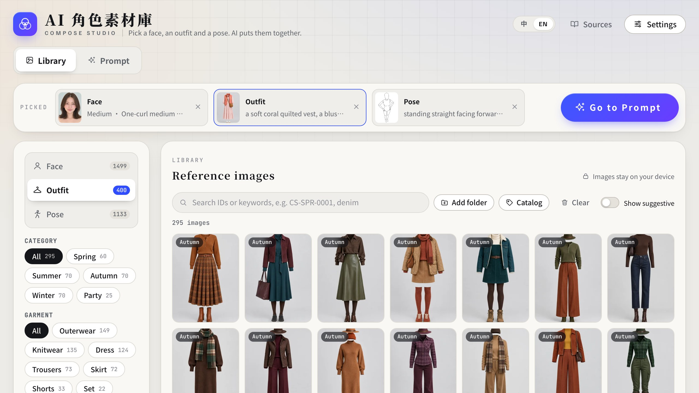

# Compose Studio (AI 角色素材庫)

**Face + outfit + pose = prompt.** Pick a face, an outfit and a pose, add scene options such as aspect ratio, shot size, camera angle and lighting, and send everything to an image model in one click. Compose Studio writes the prompt for you.

**[Open Compose Studio](https://kos5c23123.github.io/open-compose-studio/)** · **[Watch the demo (39 s)](docs/demo.mp4)**

[](docs/demo.mp4)

<sub>The screenshot and the demo use the built-in library (CC0). The demo stops at the prompt; it does not show a generated image.</sub>

Compose Studio comes with a **built-in library** of 1,499 faces, 280 poses (1,133 views) and 400 outfits, so you can start right away. You can also load your own materials from your disk. Images go straight from your device to the model you choose (a cloud API or your local ComfyUI) and never pass through any third-party server.

The interface is available in Traditional Chinese and English. Use the 中 / EN switch in the top-right corner. Prompts can be written in English, Japanese or Chinese, chosen separately in the Prompt panel.

## Getting started

1. Open **[kos5c23123.github.io/open-compose-studio](https://kos5c23123.github.io/open-compose-studio/)** in Chrome, Edge or Firefox. To run it locally instead, download or clone this repository and open `index.html` directly; no server or build step is needed. Either way, your images never leave your device except to go to the engine you choose.
2. The built-in library loads by itself. To add your own images, put each type in its own folder and choose **Load folder**.
3. Open **Settings**, pick an image engine and enter your API key or local address.
4. The page has two tabs. In **Library**, browse the images with the filters on the left and click to pick a face, an outfit and a pose; your picks stay in the **Picked** bar at the top. Press **Go to Prompt** when you are ready. In **Prompt**, the stage shows your picks and the prompt; clicking a picked image takes you back to the library.
5. In **Prompt**, pick a **quick look** (such as Studio portrait or Cinematic night) or fine-tune the scene in the Framing, Lens, Light, Setting and Subject tabs, then press **Generate**. Click any reading on the stage (for example `LENS 85mm`) to jump to that setting. When you scroll down, a floating bar keeps your picks and the Generate button in reach.

The face, outfit and pose, together with the scene settings, make up the prompt; the generated image is only its output. The fourth frame on the stage shows the prompt itself (click it to copy the prompt; edit it in the Prompt panel below), and the image appears under the Generate button. The copy icon under each chosen face, outfit and pose copies that image, so you can paste it straight into another app. Open any earlier result and press **Use this composition** to bring back the face, outfit, pose, scene settings and prompt it was made from.

An outfit image is optional; you can describe the outfit in text instead. If you would rather not connect an API, press **Copy prompt** and paste it, together with the reference images, into the ChatGPT or Gemini web app.

On iOS Safari, folder selection is not supported. Use **Choose images** to pick individual files.

### After a reload

In Chrome and Edge, Compose Studio remembers the folders you load and the face, outfit and pose you had selected. After you reload the page, a bar above the library asks you to press **Restore folders** and allow access; the folders and your selection then come back. (If you choose "Allow on every visit" in the browser prompt, they come back without asking.) The images are not copied; if a folder has been moved or deleted, it cannot be restored.

Firefox and Safari cannot remember folders, so load them again after a reload. Images added with **Choose images**, and images renamed in **Organize**, are not remembered in any browser; export Organize results as a ZIP and load that folder instead.

## Built-in library

| Type | Count | Source | License |
|---|---:|---|---|
| Faces | 1,499 (893 face, 606 styling) | [AIモデル顔データベース](https://ai-portrait-gallery.pages.dev/) by あぎ ([@agi_aibusi](https://x.com/agi_aibusi)) | CC0 |
| Poses | 280 poses, 1,133 views | [Shisei 姿勢](https://github.com/wquguru/shisei) line art | CC0 |
| Outfits | 400 women's outfits (`CS-SPR-0001` …) | Made for this project from our own prompts | CC0 |

- The repository holds web-size WebP copies: `images/<type>/w300/` for thumbnails and `images/<type>/w900/` for the image sent to the model or copied. The full-size originals stay on each source's own site.
- `data/catalog.json` is the source of truth: ids, categories, descriptions, ratings and files. `data/library.js` holds the same data as a script so the page also works from `file://`.
- Browsing categories are our own: outfits by season, garment (dress, skirt, trousers, shorts, outerwear, knitwear, set) and color, read from our outfit descriptions; poses by series, action (for example standing, sitting, kneeling, hand sign, lift) and angle, classified by eye; faces by face or styling, hair length and hair features (bob, layered, wavy, straight, wolf cut, bangs, colored), with the hairstyle names translated into Chinese and English. The tag data is in `tools/tags/` and `tools/library_tags.py`; run `python3 tools/build_library.py --retag` after editing it.
- Lingerie, swimwear and sexy outfits, and the poses Shisei rates as suggestive, are hidden until you turn on **Show suggestive** in the library.
- **Clear** removes the built-in images of that type for good (also after a reload); **Use the built-in library** brings them back.
- When the page is opened from `file://`, browsing works but sending or copying a built-in image needs the online version or a local server (`python3 -m http.server`), because browsers block reading local files from a page.

Poses keep Shisei's ids and, for the standard series, its English descriptions. Shisei's pose names and categories follow the list of [ai-pose-gallery](https://ai-pose-gallery.pages.dev/) by ギア ([@giaaibusi](https://x.com/giaaibusi)), which Shisei credits but does not license, so they are left out. The face author asks that the images themselves not be redistributed; they are included here as web-size copies. Details are in [NOTICE](NOTICE).

To rebuild the library from source folders on your own machine:

```bash
python3 tools/build_library.py --faces DIR --shisei DIR --outfits DIR --outfit-prompts FILE
python3 -I tools/verify_library.py    # checks that the catalog, library.js and images agree
```

## Browsing your own downloads by category

The filters sit in the left column of the **Library** tab. For images you load yourself, the library reads the categories that are already in the downloaded file names, so no extra data is needed:

- **Poses** (`full_single_P001_front.png`): filter by series (full body standard, full body glamour, upper body, two people) and by angle (front, high, low, side, three-quarter). The **By pose** view groups the five angles of each pose into one card; hover an angle to preview it and click to choose it. **Each image** shows every file separately.
- **Faces** (`ai-face-….png`, `ai-styling-….png`): filter by face or styling images.
- **Outfits** (`SPR-0001.png`, the name the original site gives its downloads): filter by spring, summer, autumn, winter, lingerie, party, swimwear or sexy, read from the code before the dash (`SPR`, `SUM`, `AUT`, `WIN`, `LNG`, `PTY`, `SWM`, `SXY`).

To also filter by the original sites' pose categories, pose names and hairstyles, or to search outfits by keyword (for example `denim`), load their catalog data with the **Catalog** button:

- Poses: open [ai-pose-gallery.pages.dev](https://ai-pose-gallery.pages.dev/), save the page with Ctrl+S (⌘S on Mac) and choose the saved HTML file.
- Outfits: open [ai-costume-gallery.pages.dev](https://ai-costume-gallery.pages.dev/), save the page with Ctrl+S (⌘S on Mac) and choose the saved HTML file. Only the keywords are read; the categories already come from the file names.
- Faces: open [ai-portrait-gallery.pages.dev/data/images.js](https://ai-portrait-gallery.pages.dev/data/images.js), save it and choose the file.

You can also drop those files into your materials folder; they are picked up automatically when you load the folder. The catalog is parsed in your browser and kept in its localStorage. Apart from the built-in library's face hair and style labels (CC0, see [NOTICE](NOTICE)), this repository does not include any data from the original sites.

## Material sources and rules

You can also load materials from these sites yourself. Follow each site's rules:

| Type | Source | Author | Key rules |
|---|---|---|---|
| Poses | [ポーズ集 POSE-DB-01](https://ai-pose-gallery.pages.dev/) | ギア ([@giaaibusi](https://x.com/giaaibusi)) | Free; works you create may be used commercially, and the images may be edited. **The image data itself, including processed versions, may not be redistributed, reposted or resold.** Must not be used to depict real people or minors. |
| Faces | [AIモデル顔データベース](https://ai-portrait-gallery.pages.dev/) | あぎ ([@agi_aibusi](https://x.com/agi_aibusi)) | CC0; commercial use and editing allowed. All faces are AI-generated fictional people; do not impersonate real people. The author asks that the images themselves not be redistributed. |
| Outfits | [衣装集 COSTUME-DB-01](https://ai-costume-gallery.pages.dev/) | ギア ([@giaaibusi](https://x.com/giaaibusi)) | Free; commercial creative work, editing and reference use allowed, credit optional. **The image data itself, including original-size and edited versions, may not be redistributed, reposted or resold.** All images are made with text-to-image AI; the author checked for similarity to existing brands but does not guarantee non-infringement. Must not be used to depict real people or minors. |

This summary is taken from the original sites. The latest version on each site prevails.

**Do not commit downloaded materials to this repository.** `.gitignore` excludes the `faces/`, `poses/`, `outfits/` and `materials/` folders and all image files outside `images/` and `docs/`, so those folders are a safe place to keep your downloads.

## Organizing your own materials

If you make your own pose or face images, **Organize** gives them file names that follow the same scheme, so they get the same categories, filters and pose cards as the downloaded materials.

1. Open **Organize** from the Face or Pose library (or press **Organize them** on the notice that lists images with unrecognised names). Add images with the button or by dragging them in.
2. Select one or more images (hold Shift to select a range) and set their details:
   - Poses: series code, pose number and angle (front, high, low, side, three-quarter, back; keys 1–6 also work), plus an optional series name, category and pose name. **Make one pose** gives the selected images one number and assigns the angles in order.
   - Faces: face or styling, hairstyle length, and a name code.
3. The new file name appears under each image. Clashing names are highlighted and must be fixed first.
4. Press **Add to library** to use them now, or **Export ZIP** to download the renamed images with a `catalog.json`. Loading that folder later restores the categories and names.

| Type | File name | Example |
|---|---|---|
| Pose | `{series}_P{number}_{angle}` | `my-standing_P001_front.png` |
| Face | `{face or styling}_{short, medium, semilong, long or other}_{code}` | `face_short_001.png` |

Use your own series codes rather than the original site's (`full_single` and so on) so your images never clash with downloaded ones. Only file names and catalog data change; the image content is not modified. Use only AI-generated images of fictional adults.

## Image engines

| Engine | Requires | Notes |
|---|---|---|
| Google Gemini | API key from Google AI Studio | Default model `gemini-2.5-flash-image`; change it in Settings if a newer one is available |
| OpenAI | API key | Uses `/v1/images/edits`, default model `gpt-image-1` |
| ComfyUI (local) | ComfyUI running on your machine | Start it with `--enable-cors-header` |

The Gemini, OpenAI and ComfyUI adapters have not yet been tested end to end against the live services. Please report any request or response problems.

### ComfyUI workflow

Build a workflow around an image-editing model that accepts multiple reference images (for example Qwen-Image-Edit or FLUX Kontext). Export it from ComfyUI with **Export (API)**, replace the relevant values with the placeholders below, and paste the JSON into Settings.

| Placeholder | Replaced with |
|---|---|
| `"{{IMAGE_FACE}}"` `"{{IMAGE_OUTFIT}}"` `"{{IMAGE_POSE}}"` | The reference image for that role (uploaded to ComfyUI automatically) |
| `"{{IMAGE_1}}"` `"{{IMAGE_2}}"` `"{{IMAGE_3}}"` | Reference images in prompt order |
| `"{{PROMPT}}"` | The generated prompt |
| `"{{SEED}}"` | A random seed (number) |
| `"{{WIDTH}}"` `"{{HEIGHT}}"` | Width and height of about 1 megapixel for the chosen aspect ratio (numbers) |

For example, a LoadImage node:

```json
"12": { "class_type": "LoadImage", "inputs": { "image": "{{IMAGE_POSE}}" } }
```

When a value is exactly a placeholder, it is replaced with a value of the correct type (for example a number). A placeholder inside a longer string is replaced as text. The workflow must end with a SaveImage node.

### Local LLM prompt polish (optional)

Any OpenAI-compatible endpoint works, including Ollama (`http://127.0.0.1:11434/v1`) and LM Studio (`http://127.0.0.1:1234/v1`). For Ollama, set the `OLLAMA_ORIGINS` environment variable so the browser is allowed to call it.

## Project structure

```
index.html              Markup, styles and the SVG icon sprite
js/i18n.js              Interface strings (Traditional Chinese, English) and translation helpers
js/catalog.js           File-name parsing and optional catalog import for categories
js/library-store.js     Remembers loaded folders across reloads (Chrome and Edge)
js/builtin.js           Loads the built-in library
data/catalog.json       Built-in library catalog (source of truth)
data/library.js         The same catalog as a script (generated)
images/                 Built-in library images, w300 and w900 WebP
tools/                  build_library.py, library_tags.py (browsing tags), tags/, verify_library.py
js/organizer.js         Organize dialog for naming your own materials
js/zip.js               Minimal ZIP writer used by the export
js/presets.js           Scene options (edit this file to add options)
js/prompt.js            Prompt builder (English, Japanese, Chinese)
js/adapters/registry.js Engine registry and shared helpers
js/adapters/*.js        Image engines
js/enhancer.js          Local LLM prompt polish
js/app.js               Library, selection and generation flow
```

Scripts are plain `<script>` tags sharing a global `window.Engine` namespace, so the page works when opened from `file://`.

### Adding an interface language

Add a dictionary for the new language with `Engine.i18n.add({ xx: { ... } })`, using the same keys as `js/i18n.js`, then add an entry to `Engine.i18n.langs` and a button to the `.lang-switch` group in `index.html`. Missing keys fall back to English.

### Adding an engine

Create a new file in `js/adapters/` and add a `<script>` tag for it in `index.html`:

```js
Engine.i18n.add({
  zh: { 'my.help': '顯示在設定中的說明' },
  en: { 'my.help': 'Help text shown in Settings' }
});

Engine.adapters.register({
  id: 'my-engine',
  name: { zh: '我的引擎', en: 'My engine' }, // a string, an i18n key, or { zh, en }
  kind: 'cloud',                             // or 'local'
  help: 'my.help',
  fields: [{ key: 'apiKey', label: 'field.apiKey', type: 'password' }],
  async generate({ prompt, images, aspect, size, settings, signal, onStatus }) {
    // images: [{ role: 'face' | 'outfit' | 'pose', blob, mime, name }], in the same order as the prompt
    // Return an array of Blobs
  }
});
```

## Privacy

By default, API keys are not saved. Catalog data you import is kept in this browser's localStorage until you clear it in the Catalog dialog. They are stored in the browser's localStorage only if you tick **Remember settings on this device** in Settings. Reference images are sent only from your device to the engine you choose. Generated images are kept in memory and are lost when you reload the page.

In Chrome and Edge, a reference to each folder you load (not the images themselves) is kept in this browser's IndexedDB, and the IDs of your selected images in localStorage, until you press Clear for that library.

## Acceptable use

Use only fictional people as materials. Do not use this tool to depict or impersonate real people, or to create images of anyone under 18. Generated content must follow the usage policies of the model service you use.

## License

The code is released under the MIT License (see `LICENSE`). The built-in library images are CC0 1.0 (see `LICENSE-images`). See `NOTICE` for each source.
