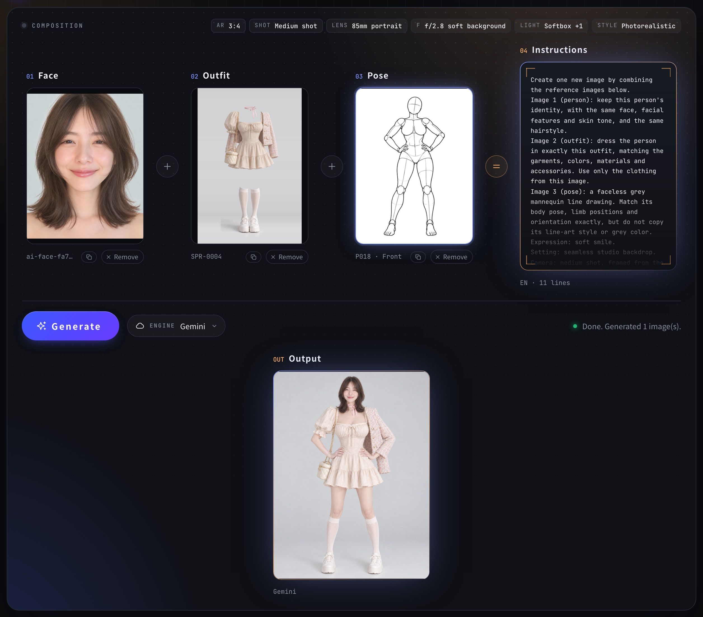

# Compose Studio (AI 角色素材庫)

**Face + outfit + pose = prompt.** Pick a face, an outfit and a pose, add scene options such as aspect ratio, shot size, camera angle and lighting, and send everything to an image model in one click. Compose Studio writes the prompt for you.

**[Open Compose Studio](https://kos5c23123.github.io/open-compose-studio/)** · **[Watch the demo (39 s)](docs/demo.mp4)**

[](docs/demo.mp4)

<sub>The screenshot and the demo use the built-in library (CC0 and ギア / CharaDB images). The demo stops at the prompt; it does not show a generated image.</sub>

Compose Studio comes with a **built-in library** of 1,499 faces, **288 poses (1,439 views)** and **2,247 outfits**: 400 made for this project, 440 CharaDB anime outfits and 1,407 ギア original outfits, with the ギア and CharaDB images included. You can also load your own materials from your disk. Images go straight from your device to the model you choose (a cloud API or your local ComfyUI) and never pass through any third-party server.

The ギア pose, depth and original outfit sets and the CharaDB anime outfits are built in (see [GIA.md](GIA.md) and [CHARADB.md](CHARADB.md)). The only optional local set is a **generated depth pack** built from Shisei's CC0 line art, which varies in quality. The app's **Settings → Depth poses** offers **Official** (the built-in 1,439 ギア depth maps), **Generated** if you install it, and **Off**. A third tab, **Analyse**, turns a reference image into an outfit or pose prompt with a vision model.

The interface is available in Traditional Chinese and English. Use the 中 / EN switch in the top-right corner. Prompts can be written in English, Japanese or Chinese, chosen separately in the Prompt panel.

## Getting started

1. Open **[kos5c23123.github.io/open-compose-studio](https://kos5c23123.github.io/open-compose-studio/)** in Chrome, Edge or Firefox. To run it locally instead, download or clone this repository and open `index.html` directly; no server or build step is needed. Either way, your images never leave your device except to go to the engine or vision service you choose.
2. The built-in library loads by itself. To add your own images, put each type in its own folder and choose **Load folder**.
3. Open **Settings**, pick an image engine and enter your API key or local address. If you want to use **Analyse**, also choose a vision service there.
4. The page has three tabs. In **Library**, browse the images with the filters on the left and click to pick a face, an outfit and a pose; your picks stay in the **Picked** bar at the top, and **Random** fills all three from the current filters. Press **Go to Prompt** when you are ready. In **Prompt**, the stage shows your picks and the prompt; clicking a picked image takes you back to the library. **Analyse** turns a reference image into an outfit or pose prompt (see below).
5. In **Prompt**, pick a **quick look** (such as Studio portrait or Cinematic night) or fine-tune the scene in the Framing, Lens, Light, Setting and Subject tabs, then press **Generate**. Click any reading on the stage (for example `LENS 85mm`) to jump to that setting. When you scroll down, a floating bar keeps your picks and the Generate button in reach.

The face, outfit and pose, together with the scene settings, make up the prompt; the generated image is only its output. The fourth frame on the stage shows the prompt itself (click it to copy the prompt; edit it in the Prompt panel below), and the image appears under the Generate button. The copy icon under each chosen face, outfit and pose copies that image, so you can paste it straight into another app. Open any earlier result and press **Use this composition** to bring back the face, outfit, pose, scene settings and prompt it was made from.

An outfit image is optional; you can describe the outfit in text instead. If you would rather not connect an API, press **Copy prompt** and paste it, together with the reference images, into the ChatGPT or Gemini web app.

On iOS Safari, folder selection is not supported. Use **Choose images** to pick individual files.

### After a reload

In Chrome and Edge, Compose Studio remembers the folders you load and the face, outfit and pose you had selected. After you reload the page, a bar above the library asks you to press **Restore folders** and allow access; the folders and your selection then come back. (If you choose "Allow on every visit" in the browser prompt, they come back without asking.) The images are not copied; if a folder has been moved or deleted, it cannot be restored.

Firefox and Safari cannot remember folders, so load them again after a reload. Images added with **Choose images**, and images renamed in **Organize**, are not remembered in any browser; export Organize results as a ZIP and load that folder instead.

## Built-in library

| Type | Count | Source | License |
|---|---:|---|---|
| Faces | 1,499 (893 face, 606 styling) | [AIモデル顔データベース](https://ai-portrait-gallery.pages.dev/) by あぎ ([@agi_aibusi](https://x.com/agi_aibusi)) | CC0 |
| Poses | 288 poses, 1,439 views | [ギア POSE-DB-01](https://ai-pose-gallery.pages.dev/) by ギア ([@giaaibusi](https://x.com/giaaibusi)) | Upstream terms; see [GIA.md](GIA.md) |
| Depth | 1,439 views | [ギア POSE-DB-02](https://ai-pose-depth-gallery.pages.dev/) by ギア | Upstream terms; see [GIA.md](GIA.md) |
| Outfits | 400 women's outfits (`CS-SPR-0001` …) | Made for this project from our own prompts | CC0 |
| ギア original outfits | 1,407 (`SPR-0001` …) | [ギア COSTUME-DB-01](https://ai-costume-gallery.pages.dev/) by ギア | Upstream terms; see [GIA.md](GIA.md) |
| CharaDB anime outfits | 440 (`ANM-001` … `ANX-436`) | [CharaDB](https://charadb-2fi.pages.dev/) by たき AI ([@taki_auto](https://x.com/taki_auto)) | Upstream reference-only; see [CHARADB.md](CHARADB.md) |

- Depth maps are built in: the official ギア POSE-DB-02 set is the default; a generated CC0 pack is optional and local.
- The ギア and CharaDB images are **not CC0**; the rest of the built-in images are CC0. See [GIA.md](GIA.md) and [CHARADB.md](CHARADB.md).
- The repository holds `w300` thumbnails and `w900` WebP. For the ギア poses/depth, ギア outfits and CharaDB outfits, `w900` is **full resolution** (900×1200 poses/depth, 1366×2048 ギア outfits, 1024×1536 CharaDB); faces and our own 400 outfits are web-size. The exact PNG/JPEG originals stay on each source's own site.
- GitHub Pages deploys only the `w300` thumbnails and the app; the full-resolution `w900` images stay in the repository and load from `raw.githubusercontent.com` on the public site, so the Pages artifact stays under the deploy limit. On a local server the app uses the local `w900` files.
- `data/catalog.json` is the source of truth: ids, categories, descriptions, ratings and files. `data/library.js` holds the same data as a script so the page also works from `file://`.
- Browsing categories are our own: outfits by season or source, and our own outfits also by garment (dress, skirt, trousers, shorts, outerwear, knitwear, set) and color; ギア/CharaDB outfits use their season or anime category. Poses by series, action (standing, sitting, kneeling, hand sign, lift, and so on) and angle; faces by face or styling, hair length and hair features (bob, layered, wavy, straight, wolf cut, bangs, colored), with the hairstyle names translated into Chinese and English. The tag data for our own outfits is in `tools/tags/` and `tools/library_tags.py`; run `python3 tools/build_library.py --retag` after editing it.
- Lingerie, swimwear and sexy outfits, and suggestive or explicit ギア poses, are hidden until you turn on **Show suggestive** in the library.
- **Clear** removes the built-in images of that type for good (also after a reload); **Use the built-in library** brings them back.
- When the page is opened from `file://`, browsing works but sending or copying a built-in image needs the online version or a local server (`python3 -m http.server`), because browsers block reading local files from a page.

Poses keep ギア's ids, Japanese pose names and categories, with the categories translated into Chinese and English action labels. The face author asks that the images themselves not be redistributed; they are included here as web-size copies. Details are in [GIA.md](GIA.md), [CHARADB.md](CHARADB.md) and [NOTICE](NOTICE).

To regenerate `data/library.js` from the committed catalog, and verify the images:

```bash
python3 tools/build_library.py --catalog-only
python3 -I tools/verify_library.py    # catalog, library.js, images and official depth agree
```

The full `--faces/--shisei/--outfits` path in `build_library.py` is for rebuilding from the original source folders; the current ギア/CharaDB catalog is committed in `data/catalog.json`.

## ギア original outfits (built-in)

The **1,407 outfits** from [衣装集 COSTUME-DB-01](https://ai-costume-gallery.pages.dev/) by ギア ([@giaaibusi](https://x.com/giaaibusi)) are part of the built-in library: `images/outfit/w300,w900/SPR-*`, `SUM-*`, `AUT-*`, `WIN-*`, `LNG-*`, `PTY-*`, `SWM-*` and `SXY-*`, with their keywords and categories in `data/catalog.json`. The **Source** filter separates them from the 400 outfits made for this project and the 440 CharaDB anime outfits.

The images are part of the built-in library. The upstream terms allow creative and commercial use but forbid redistributing the image data; they also forbid depicting real people or minors. See [GIA.md](GIA.md) and [NOTICE](NOTICE).

The exact PNG originals are not in the repository; the full-resolution `w900` WebP copies are. Do not commit downloaded archives or full-size folders; `.gitignore` excludes `outfits/` at the repository root and loose image files outside `images/` and `docs/`.

## CharaDB anime outfits (built-in)

The **440 anime outfits** by たき AI ([@taki_auto](https://x.com/taki_auto)) are part of the built-in library: `images/outfit/w300,w900/ANM-*` and `ANX-*`, with names, 15 categories and Danbooru tags in `data/catalog.json`. 396 are general (`ANM`) and 44 are suggestive (`ANX`); the 44 stay hidden until **Show suggestive**.

The images are part of the built-in library. The upstream terms make the images reference-only and forbid redistribution, reposting or resale; they also forbid depicting real people or minors. Tags/names are CC0 and the official code is MIT, but the images are neither. Details: [CHARADB.md](CHARADB.md), [upstream licence](https://github.com/taki-ttt/charadb/blob/main/LICENSE), [source site](https://charadb-2fi.pages.dev/).

The exact 1024×1536 JPEGs are not in the repository; the full-resolution `w900` WebP copies are. If you want the exact originals for local reference or to update the set, `tools/fetch_charadb.py` downloads them and builds a local app pack:

```bash
python3 -m pip install pillow opencc-python-reimplemented
python3 tools/fetch_charadb.py --yes
```

```
<compose-materials>/outfits/anime/
  original/O001.jpg …              official full-size images (440)
  app/ANM-001.webp …              900 px WebP, general
  app/ANX-013.webp …              900 px WebP, 44 sensitive items
  app/anime-meta.html             names/categories for the app
```

`--limit 8`, `--no-download` and `--out DIR` are useful for trials. Do not commit the downloaded `original/` folder.

## Depth poses (built-in official + optional generated)

The official [ギア POSE-DB-02](https://ai-pose-depth-gallery.pages.dev/) depth set is **built in**: 1,439 views in `images/pose-depth-official/w300,w900/`, with `data/depth-official.js`. It is included in the built-in library; see [GIA.md](GIA.md).

Choose **Settings → Depth poses → Depth source**: **Official** (the built-in 1,439 views), **Generated** (only if you install a local pack) or **Off**. In **Library → Pose**, the **Pose image** filter switches cards between **Line art** and **Depth map**. Selecting a pose while the depth view is on sets the pose slot to depth; the **Depth** pill on the pose slot toggles it, and the prompt then describes a depth reference. Depth maps work well as ControlNet depth inputs.

### Generated pack (optional, legacy)

`tools/make_depth_poses.py` generates depth maps from the old Shisei 1,133-view line art with [Depth Anything V2 Small](https://github.com/DepthAnything/Depth-Anything-V2) (Apache-2.0). The output is CC0, but monocular depth on pure line art is approximate, and **it does not align with the built-in ギア pose keys**; it is kept as a local experiment, not as a second production pack. If you install it, only the old Shisei ids match, so it will not add depth to the ギア poses.

```bash
python3 -m venv tools/.venv
tools/.venv/bin/pip install onnxruntime numpy scipy pillow
tools/.venv/bin/python tools/make_depth_poses.py
```

The model is cached in `tools/.cache/` (git-ignored; about 27 MB). `--model base` uses the sharper Base model, which is CC-BY-NC-4.0: personal experiments only, not for a public pack. `--limit`, `--resume` and `--workers` are useful for trials. It writes `images/pose-depth/w300,w900/` and `data/depth.js`, both git-ignored. The official pack is tracked and checked by `tools/verify_library.py`; the generated pack is not required.

## Image → prompt (Analyse)

The **Analyse** tab reverse-engineers a prompt from a photo or a screenshot:

- **Outfit** reads only the clothes: garments, colours, materials, fit and accessories.
- **Pose** reads only the body pose: stance, limb positions, camera angle and framing.

Drop an image, paste it (⌘V / Ctrl+V), or choose a file, then press **Analyse**. You get an English prompt, a Chinese prompt and tags. Copy them, or press **Use as outfit description** / **Use as pose description** to send the text to the Prompt tab; the matching image slot is cleared and the text field filled.

The analysis uses a vision model, configured under **Settings → Image analysis (Vision)**:

| Service | Default model | Credentials |
|---|---|---|
| Gemini | `gemini-2.5-flash` | the Gemini API key above |
| OpenAI | `gpt-4o-mini` | the OpenAI API key above |
| Grok | `grok-4.7` | the xAI key above |
| Local | `qwen2.5vl:7b` | any OpenAI-compatible endpoint (Ollama, LM Studio); uses the Enhancer URL when empty |

The image is downscaled to 1024 px and sent only to the service you choose. Gemini, OpenAI and xAI allow browser requests; Ollama needs `OLLAMA_ORIGINS` set, as with the Enhancer.

## Browsing your own downloads by category

The filters sit in the left column of the **Library** tab. For images you load yourself, the library reads the categories that are already in the downloaded file names, so no extra data is needed:

- **Poses** (`full_single_P001_front.png`): filter by series (full body standard, full body glamour, upper body, two people) and by angle (front, high, low, side, three-quarter). The **By pose** view groups the five angles of each pose into one card; hover an angle to preview it and click to choose it. **Each image** shows every file separately.
- **Faces** (`ai-face-….png`, `ai-styling-….png`): filter by face or styling images.
- **Outfits** (`SPR-0001.png`, the name the original site gives its downloads): filter by spring, summer, autumn, winter, lingerie, party, swimwear or sexy, read from the code before the dash (`SPR`, `SUM`, `AUT`, `WIN`, `LNG`, `PTY`, `SWM`, `SXY`).

To also filter by the original sites' pose categories, pose names and hairstyles, or to search outfits by keyword (for example `denim`), load their catalog data with the **Catalog** button:

- Poses: open [ai-pose-gallery.pages.dev](https://ai-pose-gallery.pages.dev/), save the page with Ctrl+S (⌘S on Mac) and choose the saved HTML file.
- Outfits: open [ai-costume-gallery.pages.dev](https://ai-costume-gallery.pages.dev/), save the page with Ctrl+S (⌘S on Mac) and choose the saved HTML file. Only the keywords are read; the categories already come from the file names.
- Faces: open [ai-portrait-gallery.pages.dev/data/images.js](https://ai-portrait-gallery.pages.dev/data/images.js), save it and choose the file.

You can also drop those files into your materials folder; they are picked up automatically when you load the folder. The catalog is parsed in your browser and kept in its localStorage. Apart from the built-in face labels (CC0) and the ギア/CharaDB data (see GIA.md and CHARADB.md), this repository does not include data from the original sites.

## Material sources and rules

You can also load materials from these sites yourself. Follow each site's rules:

| Type | Source | Author | Key rules |
|---|---|---|---|
| Poses | [ポーズ集 POSE-DB-01](https://ai-pose-gallery.pages.dev/) | ギア ([@giaaibusi](https://x.com/giaaibusi)) | 1,439 images included at 900×1200 (see [GIA.md](GIA.md)). Upstream terms: free for creative/commercial work and editing, but the image data may not be redistributed, reposted or resold; must not depict real people or minors. |
| Faces | [AIモデル顔データベース](https://ai-portrait-gallery.pages.dev/) | あぎ ([@agi_aibusi](https://x.com/agi_aibusi)) | CC0; commercial use and editing allowed. All faces are AI-generated fictional people; do not impersonate real people. The author asks that the images themselves not be redistributed. |
| Outfits | [衣装集 COSTUME-DB-01](https://ai-costume-gallery.pages.dev/) | ギア ([@giaaibusi](https://x.com/giaaibusi)) | 1,407 outfits included at 1366×2048 (see [GIA.md](GIA.md)). Upstream terms otherwise allow creative/commercial use and editing but forbid redistributing the image data; must not depict real people or minors. |
| Anime outfits | [CharaDB](https://charadb-2fi.pages.dev/) | たき AI ([@taki_auto](https://x.com/taki_auto)) | Images are reference-only and **may not be redistributed, reposted or resold**; do not use them to depict real people or minors. Tags/names are CC0, the code MIT; the images are neither. The 440 images are included at 1024×1536 (see [CHARADB.md](CHARADB.md)); the exact JPEGs are not included. |
| Depth poses | [Depthポーズ集 POSE-DB-02](https://ai-pose-depth-gallery.pages.dev/) | ギア ([@giaaibusi](https://x.com/giaaibusi)) | 1,439 depth views included at 900×1200 (see [GIA.md](GIA.md)). Upstream terms otherwise allow creative use but forbid redistributing the image data; bulk/automated downloading is not needed. The optional Generated pack is built from Shisei line art, not from this gallery. |

This summary is taken from the original sites. The latest version on each site prevails. The optional generated depth pack is local only.

The repository tracks the full-resolution `w900` ギア and CharaDB images. **Do not commit their full-size originals or downloads.** `.gitignore` excludes the `faces/`, `poses/`, `outfits/` and `materials/` folders, loose image files outside `images/` and `docs/`, and the optional generated depth pack (`images/pose-depth/`, `data/depth.js`). Keep archives there.

## Organizing your own materials

If you make your own pose or face images, **Organize** gives them file names that follow the same scheme, so they get the same categories, filters and pose cards as the downloaded materials.

1. Open **Organize** from the Face or Pose library (or press **Organize them** on the notice that lists images with unrecognised names). Add images with the button or by dragging them in.
2. Select one or more images (hold Shift to select a range) and set their details:
   - Poses: series code, pose number and angle (front, high, low, side, three-quarter, back; keys 1–6 also work), plus an optional series name, category and pose name. **Make one pose** gives the selected images one number and assigns the angles in order.
   - Faces: face or styling, hairstyle length, and a name code.
3. The new file name appears under each image. Clashing names are highlighted and must be fixed first.
4. Press **Add to library** to use them now, or **Export ZIP** to download the renamed images with a `catalog.json`. Loading that folder later restores the categories and names.

| Type | File name | Example |
|---|---|---|
| Pose | `{series}_P{number}_{angle}` | `my-standing_P001_front.png` |
| Face | `{face or styling}_{short, medium, semilong, long or other}_{code}` | `face_short_001.png` |

Use your own series codes rather than the original site's (`full_single` and so on) so your images never clash with downloaded ones. Only file names and catalog data change; the image content is not modified. Use only AI-generated images of fictional adults.

## Image engines

| Engine | Requires | Notes |
|---|---|---|
| Google Gemini | API key from Google AI Studio | `gemini-2.5-flash-image` |
| OpenAI | API key | `/v1/images/edits`, `gpt-image-1` |
| xAI Grok | API key from the xAI Console | `grok-imagine-image-2.0`; up to 5 reference images; `1k`/`2k` output |
| Qwen (DashScope) | Alibaba Cloud Model Studio (百煉) API key | `qwen-image-2.0-pro`; 1–3 reference images; models such as `3.0-pro`, `2.1-pro`, `edit-plus` can be typed in |
| Doubao (Ark) | Volcengine Ark API key with a Seedream/SeedEdit model | `doubao-seedream-5-0`; 1K/2K/4K; returns base64 |
| ComfyUI (local) | ComfyUI running on your machine | Start it with `--enable-cors-header` |

The browser calls the xAI, DashScope and Ark endpoints directly; all three send CORS headers, so no proxy is needed. The Grok, Qwen and Doubao adapters were tested against mocked responses, not live keys; Gemini, OpenAI and ComfyUI have not been tested end to end against the live services. Please report any request or response problems.

Qwen returns a temporary image URL (24 hours). The app downloads it to a local Blob when the bucket allows CORS, and otherwise shows the URL and lets you save it with a right-click. Doubao and Grok return base64 when asked.

### ComfyUI workflow

Build a workflow around an image-editing model that accepts multiple reference images (for example Qwen-Image-Edit or FLUX Kontext). Export it from ComfyUI with **Export (API)**, replace the relevant values with the placeholders below, and paste the JSON into Settings.

| Placeholder | Replaced with |
|---|---|
| `"{{IMAGE_FACE}}"` `"{{IMAGE_OUTFIT}}"` `"{{IMAGE_POSE}}"` | The reference image for that role (uploaded to ComfyUI automatically) |
| `"{{IMAGE_1}}"` `"{{IMAGE_2}}"` `"{{IMAGE_3}}"` | Reference images in prompt order |
| `"{{PROMPT}}"` | The generated prompt |
| `"{{SEED}}"` | A random seed (number) |
| `"{{WIDTH}}"` `"{{HEIGHT}}"` | Width and height of about 1 megapixel for the chosen aspect ratio (numbers) |

For example, a LoadImage node:

```json
"12": { "class_type": "LoadImage", "inputs": { "image": "{{IMAGE_POSE}}" } }
```

When a value is exactly a placeholder, it is replaced with a value of the correct type (for example a number). A placeholder inside a longer string is replaced as text. The workflow must end with a SaveImage node.

### Local LLM prompt polish (optional)

Any OpenAI-compatible endpoint works, including Ollama (`http://127.0.0.1:11434/v1`) and LM Studio (`http://127.0.0.1:1234/v1`). For Ollama, set the `OLLAMA_ORIGINS` environment variable so the browser is allowed to call it.

## Project structure

```
index.html              Markup, styles and the SVG icon sprite
js/i18n.js              Interface strings (Traditional Chinese, English) and translation helpers
js/catalog.js           File-name parsing and optional catalog import for categories
js/library-store.js     Remembers loaded folders across reloads (Chrome and Edge)
js/builtin.js           Loads the built-in library
js/depth.js             Depth pack manifest and pose-view pairing
data/catalog.json       Built-in library catalog (source of truth)
data/library.js         The same catalog as a script (generated)
data/depth-official.js  Built-in ギア depth manifest (1,439 views)
images/                 Built-in library images, w300 and w900 WebP
images/pose-depth-official/  Built-in ギア POSE-DB-02 depth maps
tools/                  build_library.py, library_tags.py (browsing tags), tags/, verify_library.py,
                        fetch_charadb.py (full-size local CharaDB pack), fetch_depth_poses.py (personal archive),
                        make_depth_poses.py (optional legacy generated depth)
GIA.md                  ギア source notes
CHARADB.md              CharaDB source notes
js/organizer.js         Organize dialog for naming your own materials
js/zip.js               Minimal ZIP writer used by the export
js/presets.js           Scene options (edit this file to add options)
js/prompt.js            Prompt builder (English, Japanese, Chinese)
js/adapters/registry.js Engine registry and shared helpers
js/adapters/*.js        Image engines
js/enhancer.js          Local LLM prompt polish
js/vision.js            Vision adapters for the Analyse page
js/vision-ui.js         Analyse page UI
js/app.js               Library, selection, generation and analysis flow
```

Scripts are plain `<script>` tags sharing a global `window.Engine` namespace, so the page works when opened from `file://`.

### Adding an interface language

Add a dictionary for the new language with `Engine.i18n.add({ xx: { ... } })`, using the same keys as `js/i18n.js`, then add an entry to `Engine.i18n.langs` and a button to the `.lang-switch` group in `index.html`. Missing keys fall back to English.

### Adding an engine

Create a new file in `js/adapters/` and add a `<script>` tag for it in `index.html`:

```js
Engine.i18n.add({
  zh: { 'my.help': '顯示在設定中的說明' },
  en: { 'my.help': 'Help text shown in Settings' }
});

Engine.adapters.register({
  id: 'my-engine',
  name: { zh: '我的引擎', en: 'My engine' }, // a string, an i18n key, or { zh, en }
  kind: 'cloud',                             // or 'local'
  help: 'my.help',
  fields: [{ key: 'apiKey', label: 'field.apiKey', type: 'password' }],
  async generate({ prompt, images, aspect, size, settings, signal, onStatus }) {
    // images: [{ role: 'face' | 'outfit' | 'pose', blob, mime, name }], in the same order as the prompt
    // Return an array of Blobs
  }
});
```

## Privacy

By default, API keys are not saved. Catalog data you import is kept in this browser's localStorage until you clear it in the Catalog dialog. Settings are stored in the browser's localStorage only if you tick **Remember settings on this device** in Settings. Reference images are sent only from your device to the engine you choose; an image used on the Analyse page is sent once to the vision service you choose. Generated images are kept in memory and are lost when you reload the page.

In Chrome and Edge, a reference to each folder you load (not the images themselves) is kept in this browser's IndexedDB, and the IDs of your selected images in localStorage, until you press Clear for that library.

## Acceptable use

Use only fictional people as materials. Do not use this tool to depict or impersonate real people, or to create images of anyone under 18. Generated content must follow the usage policies of the model service you use.

## License

The code is released under the MIT License (see `LICENSE`). The built-in library images are CC0 1.0 except the ギア and CharaDB images, which remain under their upstream terms (see `LICENSE-images`, `GIA.md`, `CHARADB.md` and `NOTICE`).
